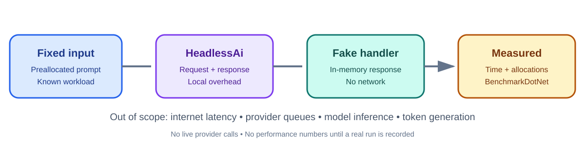

# ✳️ 00 TheSingularityWorkshop.HeadlessAi.Benchmarks

[](https://github.com/TrentBest/TheSingularityWorkshop.HeadlessAi.Benchmarks/actions/workflows/build.yml)
[](LICENSE)

<p align="center"></p>
<p align="center"><em>Measure the boundary you own. Do not confuse it with the model you call.</em></p>

## 🟦 01 The problem—and our response

AI endpoint measurements are easily distorted by network variance, provider queues, token generation, and changing model behavior. This repository isolates a reproducible portion of the stack: **HeadlessAi invocation overhead against an in-memory HTTP handler**.

It is a companion to [HeadlessAi](https://github.com/TrentBest/TheSingularityWorkshop.HeadlessAi). The benchmark harness uses BenchmarkDotNet and emits measurements locally; it does not call a live provider and does not claim to measure model speed, energy, or end-to-end user latency.

## 🟣 02 The Workshop documentation map

This repository follows the [FSM_COS Documentation Standard](https://github.com/TrentBest/TheSingularityWorkshop.FSM_COS/blob/development/DOCUMENTATION_STANDARD.md). It provides measurement evidence and methodology rather than duplicating the library's usage manual.

- [Run benchmarks](docs/usage.md) — local setup and commands.
- [Methodology](docs/methodology.md) — what is and is not measured.
- [Interpreting results](docs/interpreting-results.md) — how to avoid overclaiming.
- [Test strategy](docs/testing.md) — deterministic fixture checks.
- [Documentation index](DOCUMENTATION_INDEX.md) — all guides in reading order.

## 🩵 03 The problem and solution in depth

The measured path includes profile and adapter configuration, request construction, the injected `HttpClient` pipeline, a local fake handler, bounded response reading, and adapter response extraction. The normalized input is allocated during benchmark setup.

The path excludes DNS, TLS handshakes, network transit, provider queues, model inference, token generation, rate limits, external billing, UI rendering, and host-side planning. Those are important, but they are not stable measures of the library's local invocation overhead.

A benchmark result is meaningful only when the workload, machine, runtime, build configuration, and measurement scope are recorded. Baseline values are not advertised until a run has actually produced them and its environment is described.

## 🟢 04 See it in a minute

Prerequisite: .NET 8 SDK. Until the HeadlessAi alpha package is published, clone its source beside this repository; the CI workflow does this automatically:

```bash
mkdir -p dependencies
git clone --branch development https://github.com/TrentBest/TheSingularityWorkshop.HeadlessAi.git dependencies/HeadlessAi
dotnet restore TheSingularityWorkshop.HeadlessAi.Benchmarks.slnx
dotnet build TheSingularityWorkshop.HeadlessAi.Benchmarks.slnx --configuration Release --no-restore
dotnet test TheSingularityWorkshop.HeadlessAi.Benchmarks.slnx --configuration Release
dotnet run --project src/TheSingularityWorkshop.HeadlessAi.Benchmarks --configuration Release
```

BenchmarkDotNet will run the harness and write artifacts locally. A full benchmark can take several minutes; it is not a per-commit CI gate.

## 🟪 05 Documentation and theory

| Guide | Purpose |
|---|---|
| [Usage](docs/usage.md) | Build, run, and find artifacts |
| [Methodology](docs/methodology.md) | Define the measurement boundary |
| [Interpreting results](docs/interpreting-results.md) | Report results honestly |
| [Testing](docs/testing.md) | Check the fixture-backed path |
| [Roadmap](docs/roadmap.md) | Planned measurement extensions |

## Measurement rules

- No live provider calls in benchmarks or CI.
- No performance numbers without a recorded run and environment.
- Use Release builds and BenchmarkDotNet diagnostics.
- Keep the fake response fixed so the measured code path remains comparable.
- Separate cold-start, allocation, and steady-state questions rather than mixing them into one claim.
- NuGet publication is not a responsibility of this repository.

---

<p align="center"><em>The Singularity Workshop — Tools for the curious, the bold, and the systemically inclined.</em><br><strong>Evidence before promises.</strong></p>
